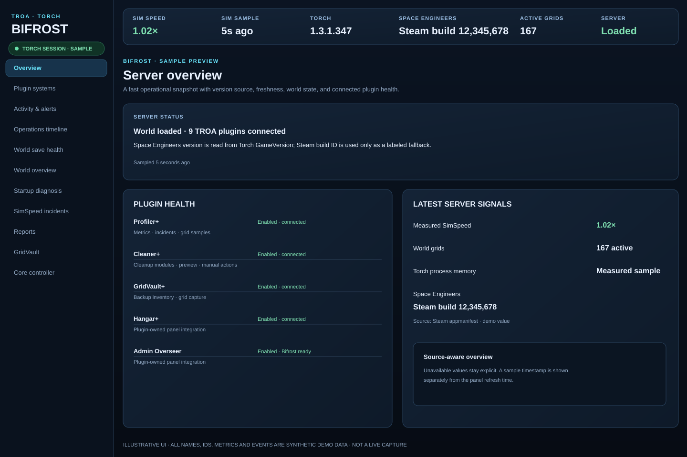
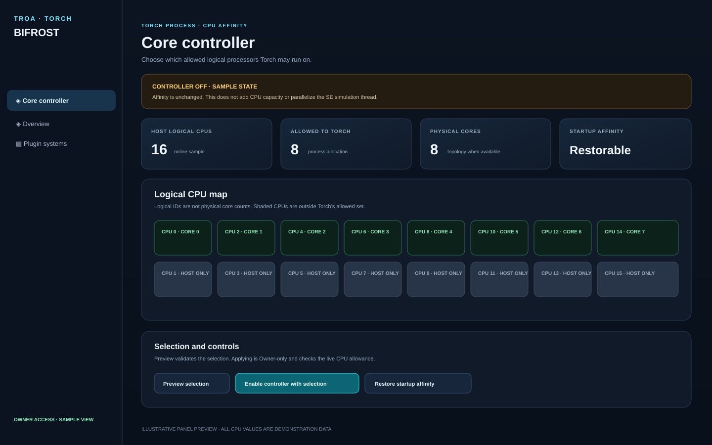
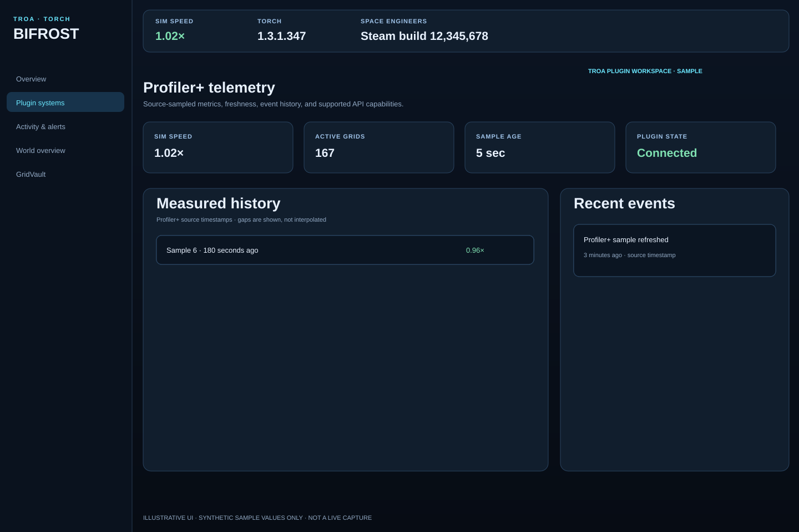

# TROA Admin Overseer

**Current build: v0.8.99 — Bifrost Operations Timeline and Incident View**

TROA Admin Overseer is a Torch plugin for Space Engineers dedicated servers. It provides player support, staff/moderation tools, roles, block limits, rewards, audit history, restart coordination, and the Bifrost Plugin Panel.

v0.8.99 adds Bifrost capability/freshness cards and a role-gated Operations timeline for timestamped plugin/audit events and Profiler+ incidents. Startup-stage timing, Cleaner+ preview, config history/impact review, scoped alerts, incident replay, and dependency mapping remain follow-up work. The CPU affinity controller remains optional, Owner-only, host-bounded, and does not make SE simulation multi-threaded.

## Bifrost Plugin Panel

Bifrost runs inside Admin Overseer and reads Torch's plugin manager. It includes individual sign-in, role-filtered views, supported TROA plugin workspaces, plugin-owned config operations, live data when exposed, command search/history, activity, analytics, Rewards, and CPU affinity controls.

The following are **illustrative UI previews with demonstration values**, not live-server captures.

## Features

- Player commands: MOTD, tickets, reports, voting/rewards, owned-grid tools and limits feedback.
- Staff tools: moderation, cases/reports, player lookup, roles, permissions, auditing, grid tools and events.
- Owner tools: config checks/reload, save, save-confirmed restart, maintenance, announcements and webhooks.
- Rewards: named bundles, vote claims, daily/playtime rewards, progress and queued grants.
- Block limits: configurable scopes/rules, previews/recounts/exports and configured enforcement.
- Bifrost plugin config is changed only through supported owning-plugin APIs.

Overseer does not own Cleaner+ cleanup, GridVault backup/recovery, or Hangar storage.

## Install

1. Stop Torch and remove older Admin Overseer ZIPs from its plugin folder.
2. Install one current package and start Torch.
3. Confirm a clean load and Bifrost listener readiness in Torch logs.
4. Run `!ova status`; keep `Instance/TROA Admin Overseer` data backed up.

Use `!ov` for player-safe commands and `!ova` for staff/owner commands. See [user guide](docs/USER_GUIDE.md), [commands](docs/COMMANDS.md), [configuration](docs/CONFIGURATION.md), [permissions](docs/PERMISSIONS.md), [Bifrost](docs/BIFROST-PLUGIN-PANEL.md), [phase roadmap](docs/BIFROST-PRODUCT-ROADMAP.md), and [release notes](docs/RELEASES.md).
