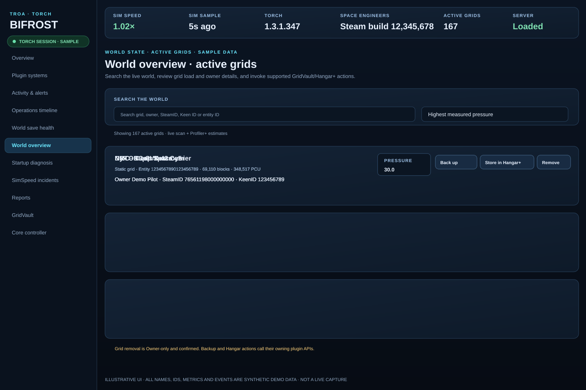
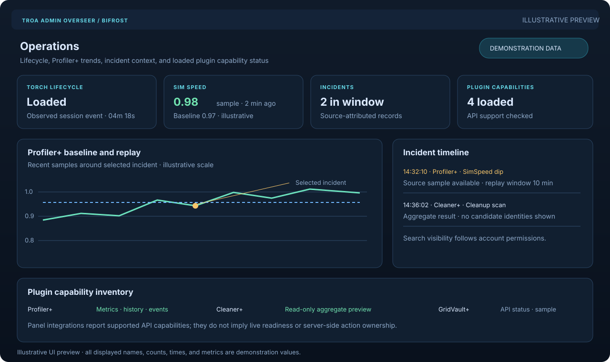
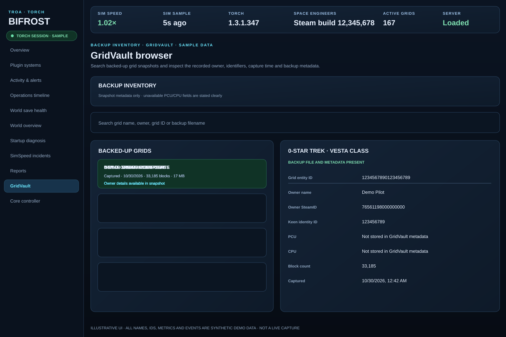
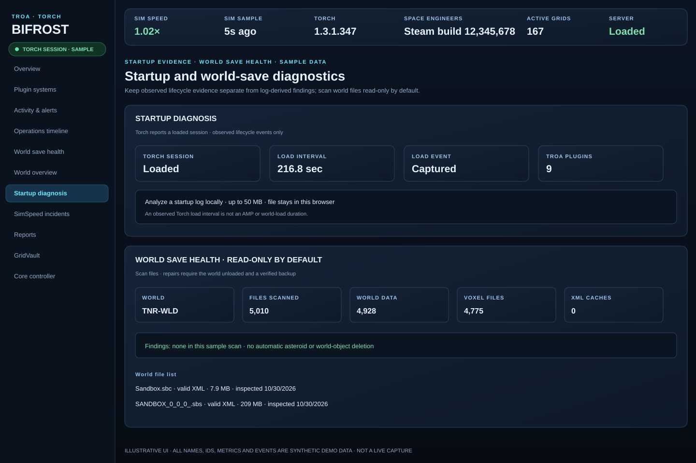
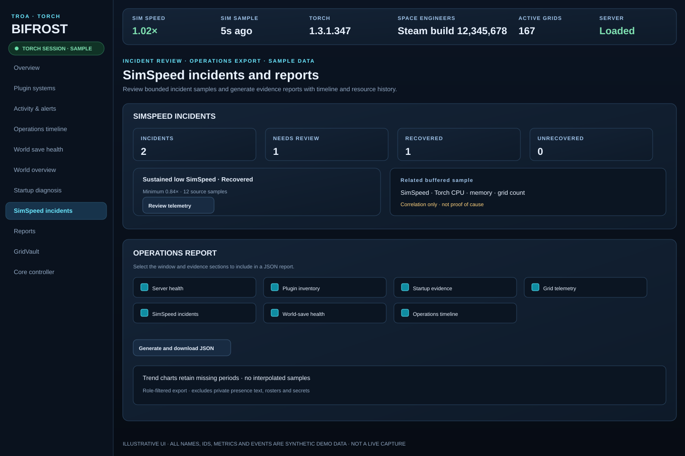
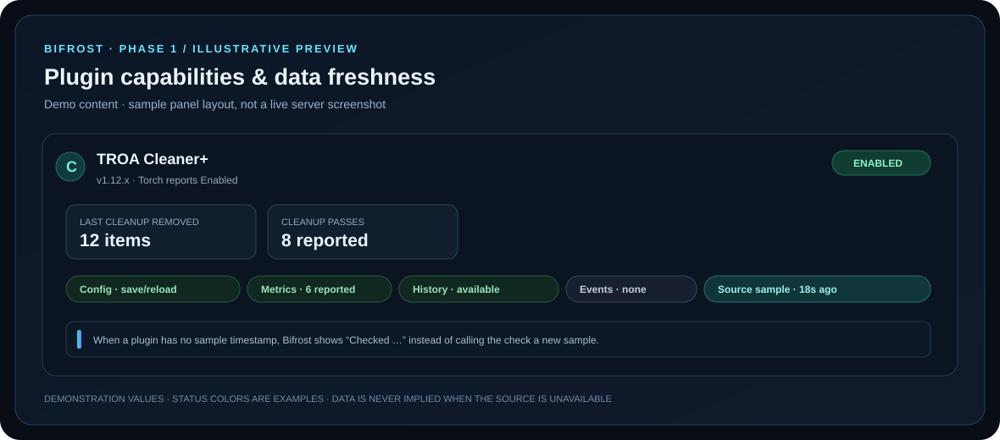

# TROA Admin Overseer

**Current build: v0.8.104 — Operational Insight and Incident Replay (Phase 5)**

A Torch administration plugin for Space Engineers dedicated servers, with the Bifrost Plugin Panel.

The Operations timeline reports the observed interval from Overseer initialization to Torch's `Loaded` event. If Overseer attaches after load, Bifrost reports current state and marks the original load time unavailable. This is Torch lifecycle timing, not AMP, world-load, Linux/Wine, storage, or full server readiness timing. Phases 1–5 are complete and separately packaged as v0.8.100–v0.8.104.

## Sequential phase releases

Each phase was completed and packaged before the next began. **Phases 1–5 are complete:** capability/freshness (.100), Torch lifecycle/diagnostics (.101), world dossiers and Cleaner+ read-only preview (.102), safer workflows (.103), and operational insight/replay (.104). See the [phase roadmap](docs/BIFROST-PRODUCT-ROADMAP.md) and [release index](docs/RELEASES.md).

## Bifrost panel previews

These updated screen previews follow the current Bifrost page structure and supported actions. Every displayed name, ID, metric, and event is synthetic sample data; these are not captures from a live server. The public release version is stated at the top of this README; panel features shown depend on the installed build and loaded plugin APIs.

<table>
<tr><td width="50%"><strong>Server overview</strong> </td><td width="50%"><strong>Active world grids</strong> </td></tr>
<tr><td width="50%"><strong>Operations and Cleaner+</strong> </td><td width="50%"><strong>GridVault inventory</strong> </td></tr>
<tr><td width="50%"><strong>Startup and world-save diagnostics</strong> </td><td width="50%"><strong>Incidents and reports</strong> </td></tr>
<tr><td width="50%"><strong>Core Controller</strong> </td><td width="50%"><strong>Plugin health and capabilities</strong> </td></tr>
<tr><td width="50%"><strong>Plugin workspace</strong> </td><td width="50%"></td></tr>
</table>

## Features

- Player support and commands, staff moderation/cases, account roles and permissions, rewards, block limits, audit history, and server announcements.
- Owner tools for configuration checks/reload, save, maintenance, and save-confirmed restart coordination with Cleaner+.
- Bifrost plugin workspaces use supported APIs owned by each plugin. Config writes and actions remain with the owning plugin; unsupported integrations are shown as unavailable/read-only.
- Optional Core Controller affinity controls are Owner-only and limited to the verified Linux process/cgroup allowance. CPU affinity does not parallelize Space Engineers' simulation thread or guarantee higher SimSpeed.
- Operations includes source-attributed lifecycle/incident records, Profiler+ baselines and replay samples, loaded plugin capability inventory, and opt-in browser-local generic notifications.

## Install

1. Stop Torch and remove older Admin Overseer ZIPs from its plugin folder.
2. Install one current package from [`releases/`](releases/) and start Torch.
3. Confirm plugin load and Bifrost readiness in Torch logs, then run `!ova status`.
4. Keep the `Instance/TROA Admin Overseer` data directory backed up.

Use `!ov` for player-safe commands and `!ova` for staff/owner commands. See the [user guide](docs/USER_GUIDE.md), [commands](docs/COMMANDS.md), [configuration](docs/CONFIGURATION.md), [permissions](docs/PERMISSIONS.md), and [Bifrost guide](docs/BIFROST-PLUGIN-PANEL.md).

Overseer does not own Cleaner+ cleanup, GridVault backup/recovery, or Hangar storage. Unsupported owner-plugin integrations remain unavailable/read-only until the owning plugin exposes an API.

See [commands](docs/COMMANDS.md), [configuration](docs/CONFIGURATION.md), [permissions](docs/PERMISSIONS.md), [Bifrost panel](docs/BIFROST-PLUGIN-PANEL.md), and [release index](docs/RELEASES.md).
